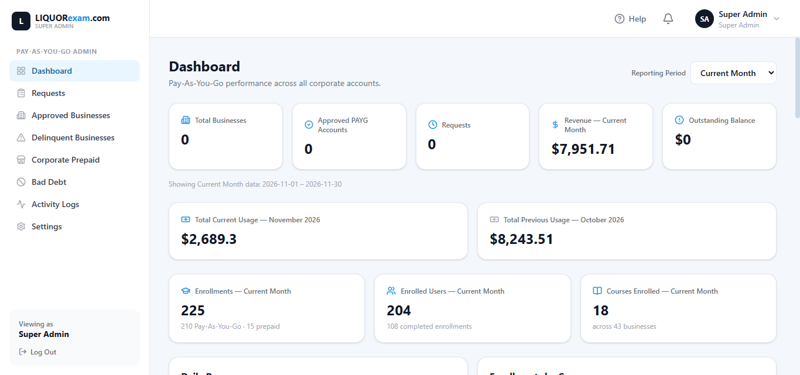
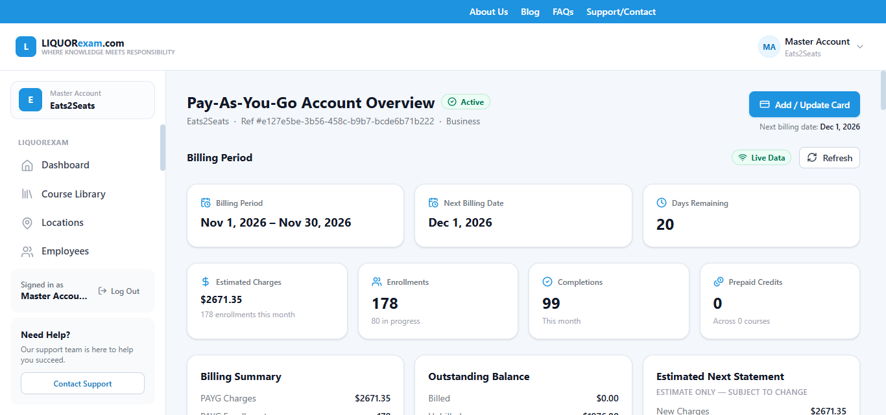
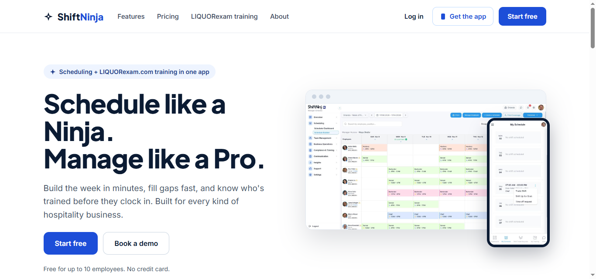
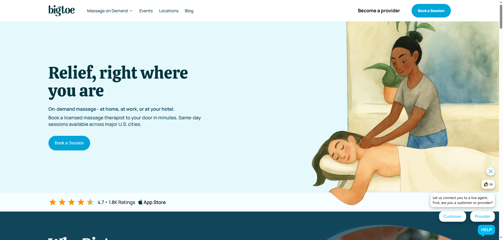
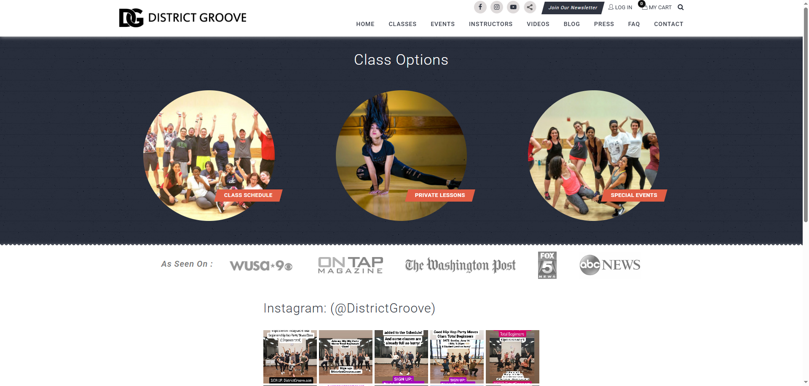
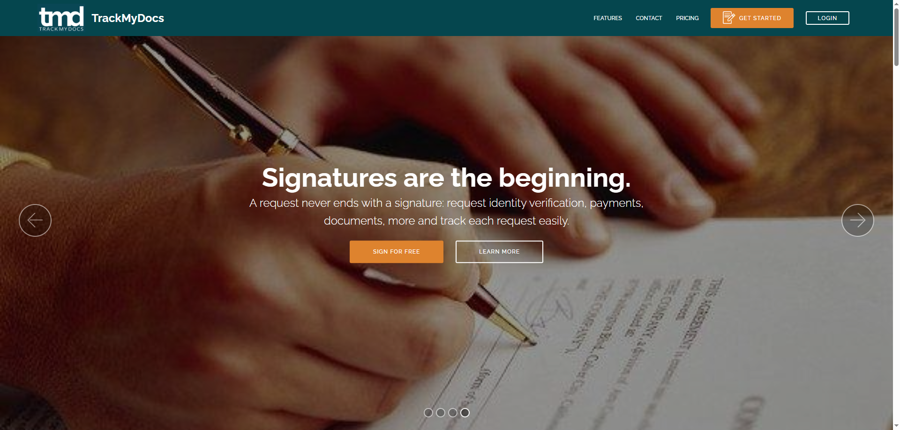

# Arvind Verma — Full Stack Developer Portfolio

Senior Full Stack Developer with 15+ years of experience building SaaS platforms, billing systems, and business web apps.

**Core stack:** PHP / Laravel · React / TypeScript · Node.js / Express.js · Angular · PostgreSQL · MySQL · Stripe

---

## Projects

| # | Project | Role | Tech Stack | Live Link |
|---|---------|------|------------|-----------|
| 1 | [LiquorExam PAYG Portal](#1-liquorexam-pay-as-you-go-payg-portal) | Full Stack Developer | Node.js, React, PostgreSQL | [payg.liquorexam.com](https://payg.liquorexam.com/) |
| 2 | [ShiftNinja](#2-shiftninja) | Full Stack Developer | React, Laravel, MySQL | [shiftninja.co](https://shiftninja.co/) |
| 3 | [Bigtoe](#3-bigtoe) | Frontend Developer | React | [bigtoe.yoga](https://www.bigtoe.yoga/) |
| 4 | [District Groove](#4-district-groove) | Full Stack Developer | Laravel | [districtgroove.com](https://www.districtgroove.com/) |
| 5 | [TrackMyDocs](#5-trackmydocs) | Full Stack Developer | Angular, Laravel, MySQL | [trackmydocs.co](https://trackmydocs.co/) |

---

## 1. LiquorExam Pay-As-You-Go (PAYG) Portal

**Role:** Full Stack Developer
**Tech Stack:** Node.js, Express.js, React, PostgreSQL, Stripe, Cron Jobs
**Live Link:** [https://payg.liquorexam.com/](https://payg.liquorexam.com/)
**Video Walkthrough:** [Watch on Loom](https://www.loom.com/share/f5693f09b8ea46579e50c1b6aae365b2)

A pay-as-you-go billing portal for LiquorExam's business customers. I designed and built it end to end — UX, UI, and the backend with Node.js, Express.js, and PostgreSQL.

**Key features:**
- Super admin panel to review and approve business owner applications
- Activity logs that record every admin action
- Stripe integration for card management and payments
- Cron jobs that generate monthly invoices based on course enrollments per user
- Business dashboard showing estimated charges, enrollments, completions, and outstanding balance
- Settings screens for Stripe and Cron configuration

**Super Admin Dashboard**

**Business Account Overview**

---

## 2. ShiftNinja

**Role:** Full Stack Developer
**Tech Stack:** React, Laravel, MySQL
**Live Link:** [https://shiftninja.co/](https://shiftninja.co/)
**Video Walkthrough:** [Watch on Loom](https://www.loom.com/share/ddcf5484f40f461e8061ef98cde66309)

A multi-tenant SaaS app for staff scheduling in restaurants, bars, and other hospitality businesses. It replaces spreadsheets with one place to build weekly schedules, manage staff availability, keep an eye on overtime, and track compliance training through the LiquorExam integration.

**Key features:**
- Drag-and-drop weekly schedule builder
- Staff availability, shift trades, and time-off requests
- Team communication
- Training and compliance tracking linked with LiquorExam
- Mobile-friendly view for employees

---

## 3. Bigtoe

**Role:** Frontend Developer
**Tech Stack:** React
**Live Link:** [https://www.bigtoe.yoga/](https://www.bigtoe.yoga/)

An on-demand massage booking platform. Customers can book a licensed massage therapist at home, at work, or at their hotel, with same-day sessions across major U.S. cities. I worked on the React frontend.

---

## 4. District Groove

**Role:** Full Stack Developer
**Tech Stack:** Laravel
**Live Link:** [https://www.districtgroove.com/](https://www.districtgroove.com/)

A dance studio website where users can browse class options, view the class schedule, book dance classes, and find private lessons and special events.

---

## 5. TrackMyDocs

**Role:** Full Stack Developer
**Tech Stack:** Angular, Laravel, MySQL
**Live Link:** [https://trackmydocs.co/](https://trackmydocs.co/)

A document workflow platform that combines document requests, electronic signatures, flexible payment options, identity verification, and custom storage options. Every request can be tracked from start to finish.

---

## Let's Work Together

If you need help with a SaaS product, billing integration, or a full stack web app, feel free to reach out on Upwork.
