# Arvind Verma — Full Stack Developer Portfolio

Senior Full Stack Developer with 15+ years of experience building SaaS platforms, billing systems, and business web apps.

**Core stack:** PHP / Laravel · React / TypeScript · Node.js / Express.js · Angular · PostgreSQL · MySQL · Stripe

---

## Projects

| # | Project | Role | Tech Stack | Live Link |
|---|---------|------|------------|-----------|
| 1 | [LiquorExam PAYG Portal](#1-liquorexam-pay-as-you-go-payg-portal) | Full Stack Developer | Node.js, React, PostgreSQL | [payg.liquorexam.com](https://payg.liquorexam.com/) |
| 2 | [ShiftNinja](#2-shiftninja) | Full Stack Developer | React, Laravel, MySQL | [shiftninja.co](https://shiftninja.co/) |
| 3 | [Bigtoe](#3-bigtoe) | Frontend Developer | React | [bigtoe.yoga](https://www.bigtoe.yoga/) |
| 4 | [District Groove](#4-district-groove) | Full Stack Developer | Laravel | [districtgroove.com](https://www.districtgroove.com/) |
| 5 | [TrackMyDocs](#5-trackmydocs) | Full Stack Developer | Angular, Laravel, MySQL | [trackmydocs.co](https://trackmydocs.co/) |
| 6 | [Sweet Crumbs](#6-sweet-crumbs--artisan-bakery-website) | UI/UX Designer & Frontend Developer | HTML, CSS, JavaScript | [sweet-crumbs-bakery-beta.vercel.app](https://sweet-crumbs-bakery-beta.vercel.app/) |
| 7 | [AutoGlow Car Care](#7-autoglow-car-care--car-wash--detailing-website) | UI/UX Designer & Frontend Developer | React | [car-wash-react-componet.vercel.app](https://car-wash-react-componet.vercel.app/) |
| 8 | [BR Traders](#8-br-traders--used-car-dealership-website) | Full Stack Developer | React, TypeScript, Tailwind CSS, Node.js | [br-traders-ten.vercel.app](https://br-traders-ten.vercel.app/) |
| 9 | [Spasation](#9-spasation--salon--spa-website) | WordPress Developer | WordPress, Elementor, Zenoti | [spasation.com](https://www.spasation.com/) |
| 10 | [NYOMS](#10-nyoms--oral--maxillofacial-surgery-practice-website) | Full Stack Developer | WordPress | [nyomsurgeons.com](https://www.nyomsurgeons.com/) |

---

## 1. LiquorExam Pay-As-You-Go (PAYG) Portal

**Role:** Full Stack Developer
**Tech Stack:** Node.js, Express.js, React, PostgreSQL, Stripe, Cron Jobs
**Live Link:** [https://payg.liquorexam.com/](https://payg.liquorexam.com/)
**Video Walkthrough:** [Watch on Loom](https://www.loom.com/share/f5693f09b8ea46579e50c1b6aae365b2)

A pay-as-you-go billing portal for LiquorExam's business customers. I designed and built it end to end — UX, UI, and the backend with Node.js, Express.js, and PostgreSQL.

**Key features:**
- Super admin panel to review and approve business owner applications
- Activity logs that record every admin action
- Stripe integration for card management and payments
- Cron jobs that generate monthly invoices based on course enrollments per user
- Business dashboard showing estimated charges, enrollments, completions, and outstanding balance
- Settings screens for Stripe and Cron configuration

**Super Admin Dashboard**

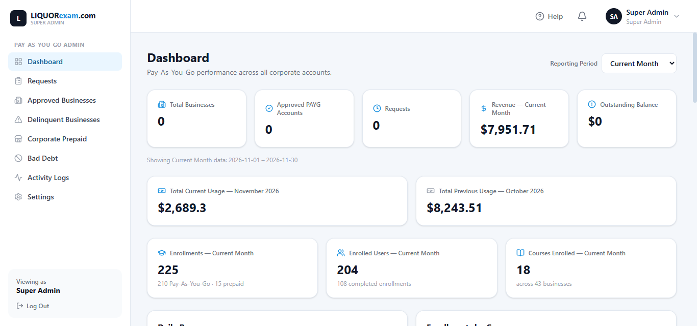

**Business Account Overview**

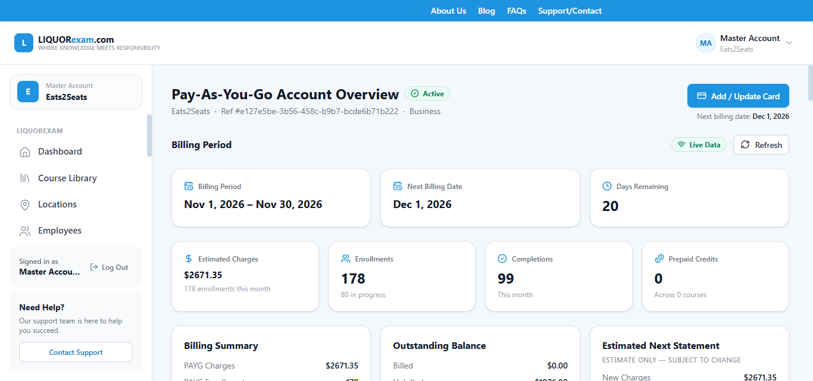

---

## 2. ShiftNinja

**Role:** Full Stack Developer
**Tech Stack:** React, Laravel, MySQL
**Live Link:** [https://shiftninja.co/](https://shiftninja.co/)
**Video Walkthrough:** [Watch on Loom](https://www.loom.com/share/ddcf5484f40f461e8061ef98cde66309)

A multi-tenant SaaS app for staff scheduling in restaurants, bars, and other hospitality businesses. It replaces spreadsheets with one place to build weekly schedules, manage staff availability, keep an eye on overtime, and track compliance training through the LiquorExam integration.

**Key features:**
- Drag-and-drop weekly schedule builder
- Staff availability, shift trades, and time-off requests
- Team communication
- Training and compliance tracking linked with LiquorExam
- Mobile-friendly view for employees

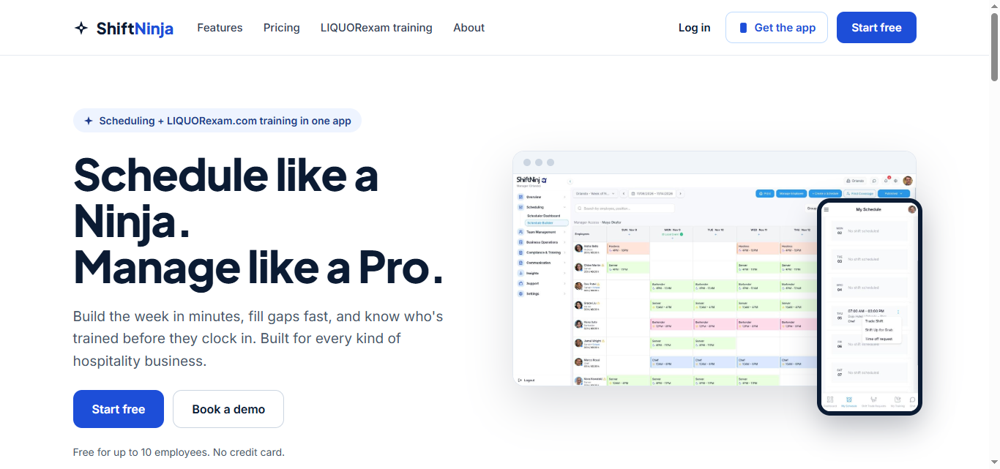

---

## 3. Bigtoe

**Role:** Frontend Developer
**Tech Stack:** React
**Live Link:** [https://www.bigtoe.yoga/](https://www.bigtoe.yoga/)

An on-demand massage booking platform. Customers can book a licensed massage therapist at home, at work, or at their hotel, with same-day sessions across major U.S. cities. I worked on the React frontend.

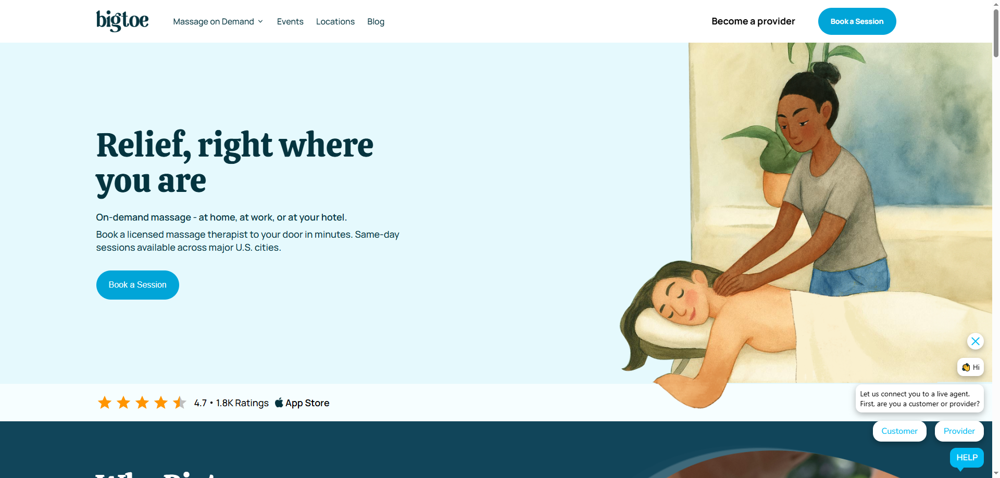

---

## 4. District Groove

**Role:** Full Stack Developer
**Tech Stack:** Laravel
**Live Link:** [https://www.districtgroove.com/](https://www.districtgroove.com/)

A dance studio website where users can browse class options, view the class schedule, book dance classes, and find private lessons and special events.

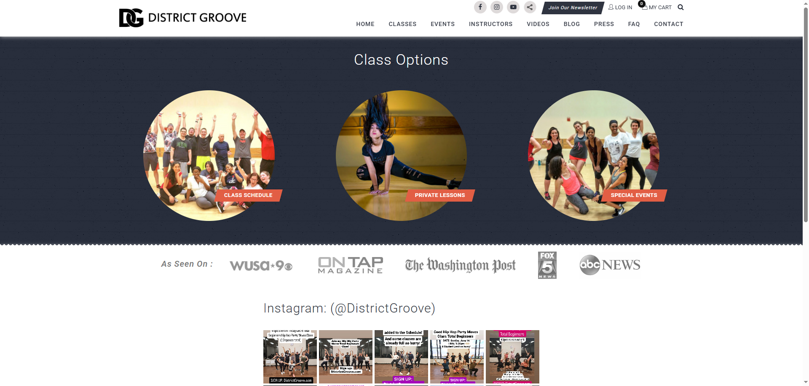

---

## 5. TrackMyDocs

**Role:** Full Stack Developer
**Tech Stack:** Angular, Laravel, MySQL
**Live Link:** [https://trackmydocs.co/](https://trackmydocs.co/)

A document workflow platform that combines document requests, electronic signatures, flexible payment options, identity verification, and custom storage options. Every request can be tracked from start to finish.

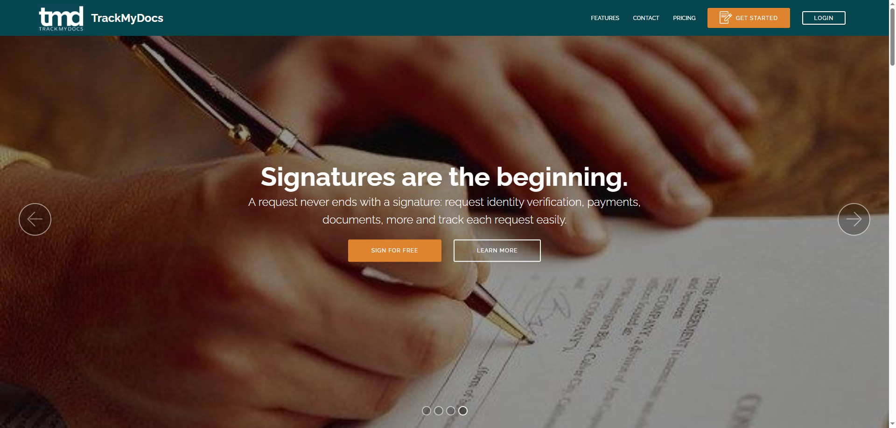

---

## 6. Sweet Crumbs — Artisan Bakery Website

**Role:** UI/UX Designer & Frontend Developer
**Tech Stack:** HTML, CSS, JavaScript
**Live Link:** [https://sweet-crumbs-bakery-beta.vercel.app/](https://sweet-crumbs-bakery-beta.vercel.app/)

A website template for a bakery and cake shop. I designed and built it from scratch, aiming for a warm, premium look that still feels easy to shop. It works well for bakeries, cake studios, and dessert brands that want to take orders online.

**Key features:**
- Hero section with a featured bestseller card, "out of the oven" timing badge, and customer rating
- Product grid with category filters (cakes, cupcakes, cookies, pastries), discount and bestseller tags, wishlist, and add-to-basket
- Bestseller spotlight section with product details and pricing
- "Freshly baked today" hourly timeline that shows what comes out of the oven and when
- Birthday collection banner that bundles cakes, cupcakes, and decoration kits
- "Why choose us" section with key highlights and stats counters
- Customer testimonial slider, Instagram gallery, and newsletter signup
- Full footer with shop links, contact details, and opening hours

**Hero Section**

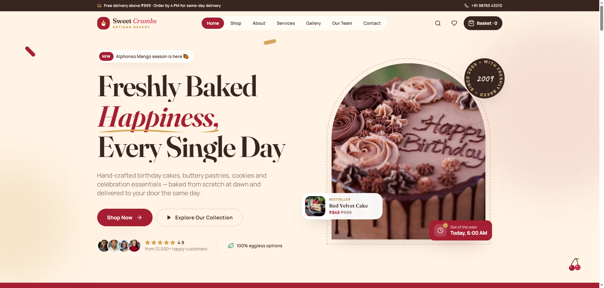

<b>Full Page Preview</b> (click to expand)

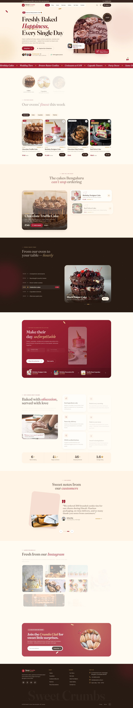

---

## 7. AutoGlow Car Care — Car Wash & Detailing Website

**Role:** UI/UX Designer & Frontend Developer
**Tech Stack:** React
**Live Link:** [https://car-wash-react-componet.vercel.app/](https://car-wash-react-componet.vercel.app/)

A website template for a car wash and detailing studio. I designed it and built it in React using reusable components. It has a clean, dark, premium look that suits the business. The layout is fully responsive, so it works well on phones, tablets, laptops, and large screens.

**Key features:**
- Mobile-first, responsive layout that adapts to any screen size
- Reusable React components for service cards, testimonials, stats, and call-to-action blocks
- Hero section with a featured package card and quick trust points
- Stats counters for vehicles cleaned, years of experience, and customer satisfaction
- Services showcase with a featured service and a list of popular services with prices and timings
- Before/after slider that lets visitors drag a handle to compare paint correction results
- "Three simple steps" booking flow and a "Why choose us" section
- Testimonial carousel, booking banner with a WhatsApp chat option, and a footer with opening hours

**Hero Section**

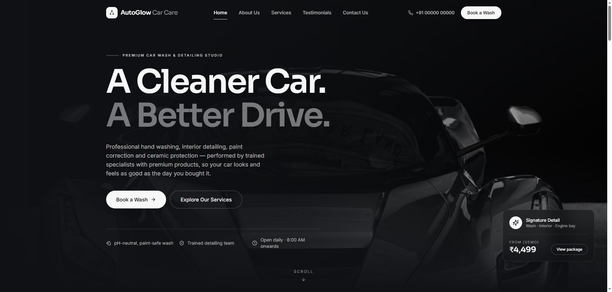

<b>Full Page Preview</b> (click to expand)

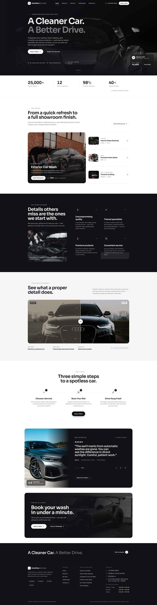

---

## 8. BR Traders — Used Car Dealership Website

**Role:** Full Stack Developer (design, development, and deployment)
**Tech Stack:** React, TypeScript, Vite, Tailwind CSS, Framer Motion, React Router, Node.js (Vercel serverless), Nodemailer, Cloudflare Turnstile
**Live Link:** [https://br-traders-ten.vercel.app/](https://br-traders-ten.vercel.app/)

A client website for BR Traders, a used car dealer on the Zirakpur–Kalka Highway in Punjab. The business buys and sells cars on commission, so the site is built to show available cars clearly and make it easy for buyers to get in touch by call, WhatsApp, or the enquiry form. I handled the design, the React frontend, the contact form backend, and the Vercel setup.

**Key features:**
- Four pages (Home, About Us, Reviews, Contact) with smooth page transitions
- Car listings with SUV, sedan, and hatchback filters, and a details popup showing year, fuel, transmission, kilometres, and price
- WhatsApp enquiry buttons on every car, plus a floating WhatsApp button and click-to-call
- Contact form backed by a Vercel serverless function that emails each enquiry to the owner
- Spam protection on the form with Cloudflare Turnstile, rate limiting, and a hidden bot check
- Customer review carousel, Google Maps location, and opening hours
- All business details kept in one config file, so phone, address, and hours are easy to update
- Fully responsive layout with a mobile menu and touch-friendly buttons

**Home Page**

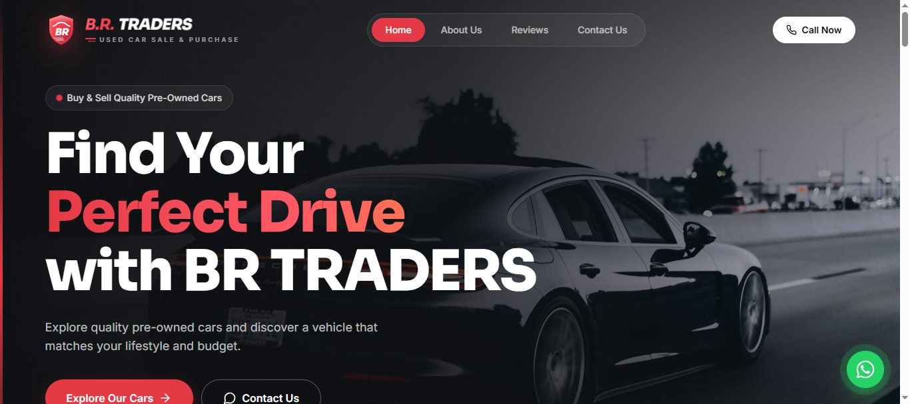

<b>About Us Page</b> (click to expand)

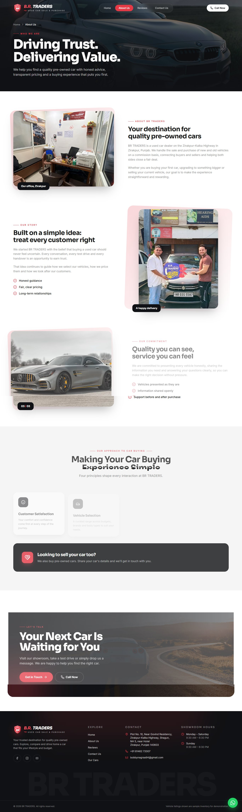

---

## 9. Spasation — Salon & Spa Website

**Role:** WordPress Developer
**Tech Stack:** WordPress, Elementor, Slider Revolution, Zenoti (online booking), Google Tag Manager, Cloudflare
**Live Link:** [https://www.spasation.com/](https://www.spasation.com/)

A website for Spasation Salon & Spa, a beauty spa and hair salon with three locations in Edmonton, Canada. The site lists all spa and salon services with prices, and lets customers book appointments and buy gift cards online through Zenoti.

**Key features:**
- Hero slider with promotions and a "Contact Us" call to action
- Beauty Spa and Hair Salon menus covering massage, facials, laser hair removal, nails, brows and lashes, bridal hair and makeup, and more
- Service cards with starting prices and "Book Now" buttons linked to Zenoti online booking
- Gift card and e-certificate purchase through the Zenoti webstore
- Location pages for Calgary Trail, Kingsway Mall, and Londonderry Mall, with a phone number for each in the top bar
- Announcement bar for news like a new location opening
- Link to the separate online product store

**Home Page**

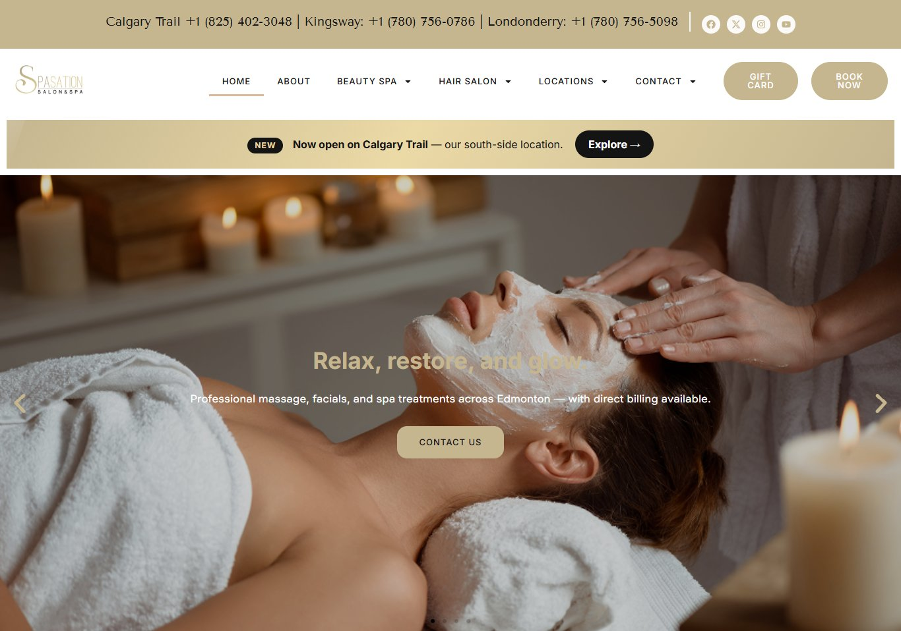

---

## 10. NYOMS — Oral & Maxillofacial Surgery Practice Website

**Role:** Full Stack Developer
**Tech Stack:** WordPress
**Live Link:** [https://www.nyomsurgeons.com/](https://www.nyomsurgeons.com/)

A WordPress website for NYOMS (Steven R. Schwartz, DDS), an oral and maxillofacial surgery practice in Brooklyn, New York. The practice diagnoses and treats conditions, injuries, and aesthetic concerns of the mouth, teeth, jaws, and face, so the site needed to explain these procedures clearly and make it easy for patients and referring dentists to get in touch.

**Key features:**
- Full-screen video hero with the practice name and specialty
- Top bar with phone number, office hours, address, and social links (Facebook, Google, Yelp)
- Dropdown menus for About Us, Patient Information, and Procedures
- Patient and referral forms section for new patients and referring dentists
- Contact page with the office location and opening hours

**Home Page**

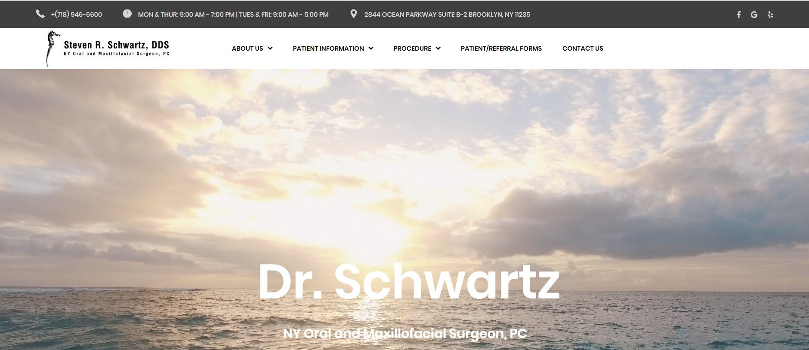

---

## Let's Work Together

If you need help with a SaaS product, billing integration, or a full stack web app, feel free to reach out on Upwork.

## 📫 Get in touch

- **UpWork Profile:** [Arvind Verma](https://www.upwork.com/freelancers/~01acfe4bc5ff805def)
- **Email:** [arvindeng.verma@gmail.com](mailto:arvindeng.verma@gmail.com)
